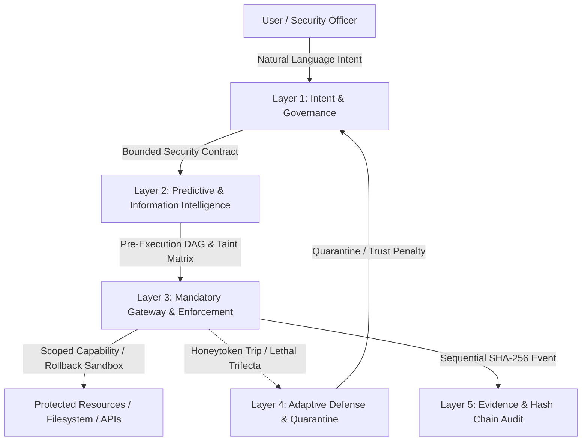

# INTENTLOCK 3.0: System Architecture & Security Specification

**Predict the Threat. Trace the Data. Control the Action. Contain the Risk.**

---

## 1. Executive Summary

IntentLock 3.0 is a model-independent, runtime security and governance framework positioned between autonomous AI agents and sensitive resources. Unlike conventional static role-based access control (RBAC), IntentLock dynamically evaluates intent contracts, pre-execution DAG threat simulations, cryptographic Proof-of-Possession, attenuating delegations, and Data DNA taint propagation.

---

## 2. Five-Layer Architecture Overview



---

## 3. The 5 Security Layers & 24 Modules

### LAYER 1: INTENT AND GOVERNANCE
- **Module 1: Intent-to-Contract Compiler (`compiler.py`)**: Rule-based compiler translating natural-language prompts into formal JSON contracts. Enforces safe defaults, flags broad scopes, and denies deletions without dual approval.
- **Module 2: Multi-Agent Identity Registry (`registry.py`)**: Asymmetric keypair provisioning (`ed25519_pk_*`), Proof-of-Possession credentials, rotation, and lifecycle tracking.
- **Module 3: Task Contract and Policy Manager (`policy_manager.py`)**: Deterministic policy decisions (`ALLOW`, `DENY`, `REQUIRE_APPROVAL`, `FLAG_FOR_REVIEW`). Mandatory denials cannot be overridden by risk scores.
- **Module 4: Adaptive Agent Trust Engine (`trust_engine.py`)**: Dynamic 0-100 score (`NORMAL`, `WARNING`, `RESTRICTED`, `QUARANTINED`). Auditable trust adjustment events.

### LAYER 2: PREDICTIVE & INFORMATION INTELLIGENCE
- **Module 5: Predictive Threat Simulation Engine (`simulator.py`)**: Pre-execution DAG graph analyzer. Distinguishes `PREDICTED`, `SIMULATED`, `OBSERVED`, and `UNKNOWN` states.
- **Module 6: Data DNA & Taint Tracking (`data_dna.py`)**: Conservative sensitivity inheritance (`RESTRICTED` > `CONFIDENTIAL` > `INTERNAL` > `PUBLIC`), taint tracking, and **Lethal-Trifecta** detection.
- **Module 7: Contextual Risk Engine (`risk_engine.py`)**: Deterministic 0-100 score based on agent trust, resource classification, delegation depth, and payload patterns.
- **Module 8: Workflow Behavior Analyzer (`behavior_analyzer.py`)**: Sliding-window tracking of velocity, anomaly bursts, and probing patterns.
- **Module 9: Anti-Exfiltration & Slow-Leak Detection (`anti_exfiltration.py`)**: Destination allowlists, egress budgets, and regex/base64 payload scanning.
- **Module 10: Privacy-Preserving Tokenization (`tokenization.py`)**: Replaces SSNs and IDs with `{{SSN_REDACTED_XXX}}` before agent viewing; only authorized backend adapters detokenize.

### LAYER 3: ENFORCEMENT & VERIFIED EXECUTION
- **Module 11: Mandatory Execution Gateway (`gateway.py`)**: The central 12-step validation pipeline. Ephemeral single-use capability broker.
- **Module 12: Context-Bound Cryptographic Approval (`approval.py`)**: Canonical JSON (RFC 8785) digests, HMAC-SHA256 signatures, and atomic single-use nonce consumption.
- **Module 13: Attenuating Delegation Tokens (`delegation.py`)**: Hierarchical delegation trees where child scope $\subseteq$ parent scope. Monotonic attenuation.
- **Module 14: Proof-of-Possession Authentication (`signatures.py`)**: Cryptographic request signing, timestamp freshness ($\le 60\text{s}$), and nonces to block replay attacks.
- **Module 15: Tool Registry & Supply-Chain Integrity (`tools.py`)**: Immutable manifest digest verification, quarantine on modification.
- **Module 16: Hardened Code Sandbox (`sandbox.py`)**: Safe directory boundaries, strict path traversal traps (`../../`), and file checkpoints for rollback.

### LAYER 4: ADAPTIVE DEFENSE & RESPONSE
- **Module 17: Autonomous Quarantine (`quarantine.py`)**: 3 response levels (`WARNING`, `RESTRICTED`, `QUARANTINED`). Deactivates active keys.
- **Module 18: Security Deception & Honeytokens (`deception.py`)**: Injects canary tokens into decoys. Accessing trips instant Level 3 Autonomous Quarantine.
- **Module 19: Transactional Execution & Recovery (`transaction.py`)**: Pre-action checkpoints and automatic rollback on execution error or policy abort.
- **Module 20: Predictive Blast-Radius Containment (`blast_radius.py`)**: Cascading containment of child agents, active delegations, and contracts.

### LAYER 5: EVIDENCE & CONTINUOUS IMPROVEMENT
- **Module 21: Policy Evolution & Shadow Mode (`shadow_mode.py`)**: Non-blocking simulation of proposed policies against historical traffic.
- **Module 22: Tamper-Evident Audit Hash Chain (`audit_chain.py`)**: Sequential SHA-256 chain $H_i = \text{SHA256}(H_{i-1} \parallel \dots)$. Integrity verification algorithm.
- **Module 23: Security Coverage Dashboard (`dashboard_service.py`)**: Real-time DB-backed metrics and coverage status mapping.
- **Module 24: Continuous Security Evaluator (`evaluator.py`)**: Automated 8-scenario red-team penetration test suite computing a quantitative Security Resilience Score.

---

## 4. The 12-Step Gateway Pipeline

```
1. Receive Request 
   -> 2. Validate Schema 
   -> 3. Authenticate Agent (PoP Signature & Nonce) 
   -> 4. Validate Task Contract 
   -> 5. Check Resource Bounds & Honeytokens 
   -> 6. Compute Contextual Risk (0-100) 
   -> 7. Inspect Data DNA & Lethal-Trifecta 
   -> 8. Verify Context-Bound Cryptographic Approval (if mutative/high-risk) 
   -> 9. Revalidate Resource State 
   -> 10. Issue Scoped Execution Capability Ticket 
   -> 11. Execute via Hardened Sandbox Tool Adapter (with rollback checkpoint) 
   -> 12. Record to Immutable Sequential SHA-256 Hash Chain
```
